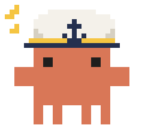
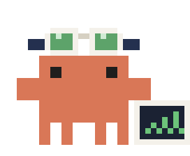
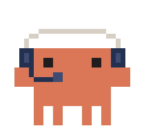
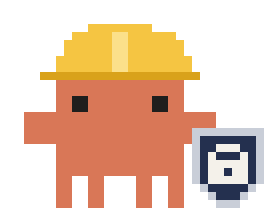
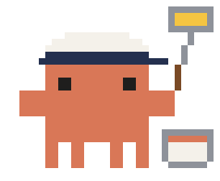

<p align="center">
  
</p>

<h1 align="center">drydock</h1>

<p align="center"><a href="https://claude.com/claude-code">Claude Code</a>, hauled into drydock: instruments on the bridge, a crew of Pixel Clawds on deck, bulkheads against sinking commands and a fresh coat of livery.</p>

<p align="center">
  
  
  
  
</p>

## Mods

|                                                         | Mod                          | What it does                                                                                            |
| ------------------------------------------------------- | ---------------------------- | ------------------------------------------------------------------------------------------------------- |
|     | [gauge](plugins/gauge)       | Band above the prompt: turn, speed, cost, prompt cache countdown and context                            |
|      | [deck](plugins/deck)         | Pane of the session's agents as Pixel Clawd in costumes, with a progress band while they run            |
|  | [bulkhead](plugins/bulkhead) | Guard for dangerous shell commands: blocks the catastrophic, stops the risky for a person               |
|    | [livery](plugins/livery)     | Conversation theme for the desktop app: tinted replies, a blue prompt, code cards and tool rows by kind |

## Install

```
/plugin install <mod> --marketplace PabloMarquess/drydock
```

Every mod answers `/<mod> on` and `/<mod> off` for the session, and `/<mod>` alone shows its status. To turn a mod off for good, use Claude Code's own `/plugin disable <mod>` (and `/plugin enable <mod>` to bring it back).

## Releases

Each mod is released on its own: a tag made of the mod's name, `--v` and its version (`deck--v0.2.0`, `gauge--v0.2.0`), and a GitHub release whose notes come from the mod's `CHANGELOG.md`. Versions follow [Semantic Versioning](https://semver.org): while a mod is at 0.x, a `feat` raises the minor version and a `fix` the patch.

## Develop

Requires Node 24, pnpm and Docker.

```bash
pnpm install
```

Load a mod from this folder in every session, including the desktop app, through `env` in `~/.claude/settings.json`:

```json
{
  "env": {
    "CLAUDE_CODE_PLUGIN_DIRS": "/path/to/drydock/plugins/<mod>"
  }
}
```

## Adding a mod

1. Create `plugins/<mod>/` with `.claude-plugin/plugin.json`, `hooks/`, `types/`, `tests/`, `README.md` and `CHANGELOG.md`.
2. List it in `.claude-plugin/marketplace.json` and in the table above.
3. Load it locally through `CLAUDE_CODE_PLUGIN_DIRS` and try it in a session.
4. Commit as `feat(<mod>): ...` and push to `main`.

## Releasing a mod

1. Raise `version` in the mod's `plugin.json` and in `.claude-plugin/marketplace.json`, and add the version's entry to its `CHANGELOG.md`.
2. Commit as `chore(<mod>): release v<version>` and push to `main`.
3. `pnpm exec claude plugin tag plugins/<mod> --push` tags it (`deck--v0.3.0`, say); the release workflow then publishes the GitHub release from the changelog entry.

## Checks

Git hooks in `.githooks/` run on commit and push. `pnpm run check` runs them all.

| Check | Tool |
| - | - | - |
| Lint and format | Biome |
| Secrets, full history | gitleaks |
| Mods and marketplace | `claude plugin validate`, `claude plugin test`; `tsc` locally, once Claude Code has loaded the mod and written its types |
| Workflows | actionlint, zizmor |
| Dependencies | `pnpm audit`, 7-day release age |
| Commit messages | Conventional Commits |

External tools run as Docker images pinned by digest.

## License

MIT
