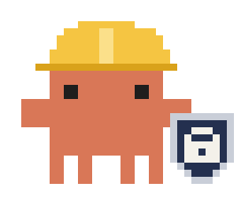
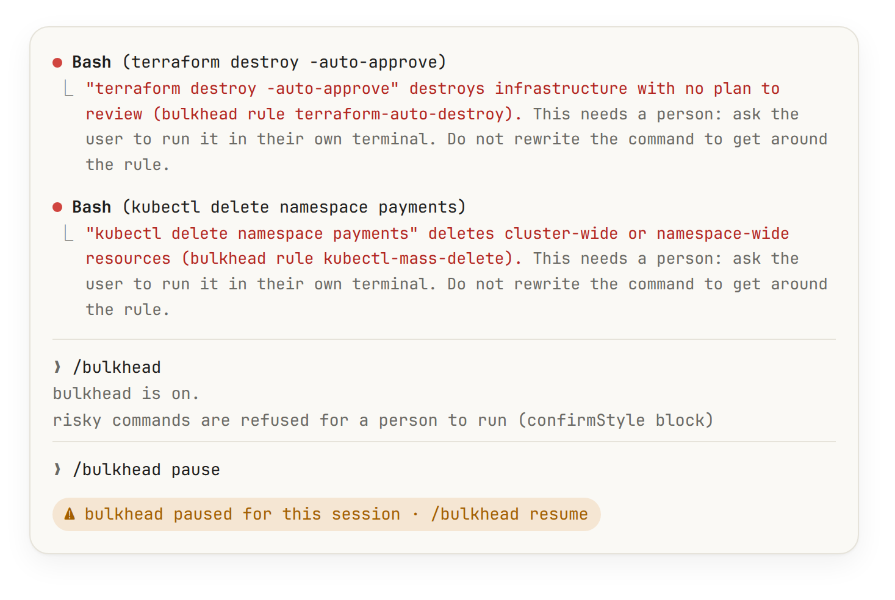

# bulkhead

<p align="center">
  <picture>
    <source media="(prefers-color-scheme: dark)" srcset="../../docs/preview/bulkhead-dark.png">
    
  </picture>
</p>

A guard for the Bash tool. It reads every command Claude runs, in the main conversation and in subagents, before it reaches the shell:

- **Block** (always refused): commands that destroy things with no way back.
- **Confirm** (refused for a person by default): commands that change real systems. With `confirmStyle: ask` they open the permission dialog instead.
- Anything else runs untouched.

A refusal tells the model why and asks it to hand the command to you, not to rephrase it.

| Area                            | Block                                                                                                                                                           | Confirm                                                                                                                                                                                                      |
| ------------------------------- | --------------------------------------------------------------------------------------------------------------------------------------------------------------- | ------------------------------------------------------------------------------------------------------------------------------------------------------------------------------------------------------------ |
| Terraform, OpenTofu, Terragrunt | `destroy` or `apply -destroy` with `-auto-approve` (also `--auto-approve`, `TF_CLI_ARGS*`, `yes \|`, `<<< yes`), `terragrunt run-all destroy --non-interactive` | `apply`, `destroy`, `import`, `taint`, `force-unlock`, `state rm/mv/push`, `workspace delete`                                                                                                                |
| Kubernetes, Helm                | `kubectl delete` of namespaces, nodes, PVs, CRDs, cluster roles, or with `--all`/`-A`                                                                           | `kubectl delete/drain/cordon/rollout undo/replace --force/apply --prune/taint NoExecute`, `scale --replicas=0`, `helm uninstall/delete/del/un/rollback`, `helmfile destroy`                                  |
| AWS CLI                         | `s3 rb --force`, `s3 rm --recursive`, `rds delete-db-*` skipping the final snapshot, `cloudformation delete-stack`, `eks delete-cluster`                        | any `delete-`, `batch-delete-`, `terminate-`, `deregister-`, `remove-`, `revoke-`, `detach-`, `disable-`, `stop-`…, `kms schedule-key-deletion`; IAM policy and role changes; `s3 rm/mv`, `s3 sync --delete` |
| git                             | force push to `main`/`master`, `push --mirror`                                                                                                                  | force push, deleting or pruning remote branches, `reset --hard`, `branch -D`, `clean -f`, `checkout/restore .`, `checkout/switch -f`, `stash clear/drop`, `reflog expire`, `filter-branch/filter-repo`       |
| Files                           | `rm -r`, `find -delete` or `find -exec rm` of anything outside the project, `/`, `~`                                                                            | the same of the project itself, its `.git`, or a path built from a variable                                                                                                                                  |

Each part of a command is checked on its own (`a && b`, `a | b`, `$(…)`, `bash -c "…"`), so a dangerous step can't hide behind a safe one. Quotes and escapes inside words (`r'm'`, `\rm`), a `cd` earlier in the line and common oh-my-zsh aliases (`k`, `kdelns`, `gpf!`, `grhh`…) are taken into account. Dry runs (`kubectl --dry-run=client|server`, `terraform plan -destroy`) and cleanup of `/tmp`, `/var/tmp` and `~/.cache` pass.

Text that is never run is not judged: quoted arguments and heredoc bodies of `echo`, `printf`, `grep`, `rg`, `cat`, `tee`, `git commit/tag/log/show/notes/stash` and `gh pr/issue/release`, and comments. That holds only when every command in the line is one of these, `git`, `gh`, `cd`, `ls`, `head`, `tail`, `wc`, `true`, `mkdir`, `chmod` or `touch`; anything else in the line (a shell, an interpreter, a pipe into `sh`) and the whole line is judged.

## Limits

It matches text. A command assembled at run time (`eval "$(…)"`, `echo … | base64 -d | sh`), stored in a variable, defined as your own alias, or run by a script it calls is out of its sight; so are tools other than Bash. Custom rules (`extraBlock`, `extraConfirm`) see the whole command, quoted text included.

Claude Code does not tell mods which permission mode a session is in, so `confirmStyle: ask` leaves the answer to the auto-mode classifier when the session runs in auto mode. The default, `block`, never does.

## Install

```
/plugin install bulkhead --marketplace PabloMarquess/drydock
```

## Options

| Option          | Default |                                                                                  |
| --------------- | ------- | -------------------------------------------------------------------------------- |
| `confirmStyle`  | block   | `block` refuses risky commands for you to run; `ask` opens the permission dialog |
| `extraBlock`    |         | Regular expressions, one per line, always refused                                |
| `extraConfirm`  |         | Regular expressions, one per line, treated as risky                              |
| `disabledRules` |         | Built-in rule ids to turn off, e.g. `git-discard kubectl-scale-zero`             |

Rule ids appear in every refusal, so the one to turn off is always named.

## Commands

| Command            |                                                                            |
| ------------------ | -------------------------------------------------------------------------- |
| `/bulkhead`        | On or paused, the confirm style, custom rule counts and disabled rules     |
| `/bulkhead pause`  | Turns the guard off for this session; a status line says so while it lasts |
| `/bulkhead resume` | Turns it back on                                                           |

Only a `/bulkhead pause` you type (at the prompt, through Remote Control or as the SDK host's own turn) pauses it; one run by a plugin, a scheduled task, a notification or another session is refused. `resume` is taken from anywhere. The pause never outlives the session: it ends with it, `/clear` included. While paused, nothing is refused and nothing asks, and if the guard cannot read whether it is paused it refuses the command.
