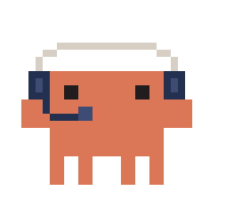
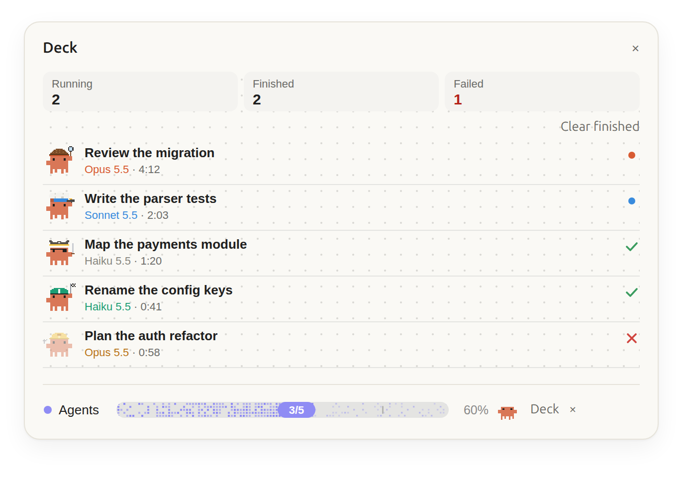

# deck

<p align="center">
  <picture>
    <source media="(prefers-color-scheme: dark)" srcset="../../docs/preview/deck-dark.png">
    
  </picture>
</p>

A pane with the session's subagents and workflow agents, one row each, and a band above the prompt while a batch of agents runs. Each agent is Pixel Clawd, the crab, in a costume for its model.

```
1 running · 1 finished

▣ Index the monorepo                                ●
  Opus 5.5 · 12:40
  memory 84% · large and costly per call

▣ Review the migration                              ✓
  Sonnet 5.5 · 3:12
```

That is the terminal. The desktop, VS Code and the mobile app draw the same rows over claude-kit's dotted grid: the crab on the left, the title in bold, the model in the costume's colour, a status mark on the right (a pulsing dot while the agent runs, ✓ when it answered, ✗ when it failed) and a hairline under each row. Their header has a tile for Running and one for Finished, and a red Failed tile only when an agent failed. Running agents come first, newest on top, then the finished ones. The pane draws 30 rows at most; the rest wait behind a count (`5 more agents not shown`) and still add to the header. Agents an engine fork starts (compaction, memory) are not listed. `Clear finished` drops the finished and failed rows.

The daily view stays lean: how many run, finish or fail, and per agent its title, model and time. Memory shows up only when it matters (see below); cost, time totals, requests and tokens wait behind `/deck details`.

## What each number means

| Shown                        | Meaning                                                                                                                                                                                                                           |
| ---------------------------- | --------------------------------------------------------------------------------------------------------------------------------------------------------------------------------------------------------------------------------- |
| Running, Finished (header)   | Agents running now, and agents that answered. A failed agent is not counted as finished.                                                                                                                                          |
| Failed (header)              | Agents that ended in an error; the tile shows only when there is one, and the row shows ✗.                                                                                                                                        |
| Time on a row                | From the agent's start to its end, or to now while it runs. An agent asked again (a background agent, a teammate) adds its new run, not the wait before it.                                                                       |
| Cost (details)               | The header tile sums the listed agents' estimated costs; each row's details line shows its own (see Cost below).                                                                                                                  |
| Time (details header)        | Wall time during which at least one listed agent was running. Agents running side by side count once, and the gaps when none ran do not count: two agents working the same minute, then a 30-second one an hour later, make 1:30. |
| `requests` (details)         | Model requests the agent made.                                                                                                                                                                                                    |
| `tokens processed` (details) | Every request's whole prompt plus its output, summed. Each request sends the agent's conversation again, so this counts the same conversation many times over: it grows much faster than memory, and it is what the cost follows. |
| `memory` (details, warning)  | The last request's size (prompt plus output) over the model's window: `160k / 1M (16%)`. The window is 1M tokens, or 200k for Haiku 4.x and Claude 3 models.                                                                      |

## The memory warning

Below 70% the lean row says nothing about memory. From 70%, while the agent runs, the row adds a line in the warning colour: `memory 84% · large and costly per call`.

- Why it matters: every call the agent makes resends that whole prompt, so each call costs more than the last, and near 100% the agent compacts its conversation (losing detail) or fails.
- What to do: usually nothing. If the agent is close to done, let it finish. If it keeps going and the percent and the cost keep climbing, stop it and give the rest of the work to new agents with narrower tasks; next time, split a task that large before launching it.
- How often: rarely. With the 1M window of current models an agent seldom gets there.

A finished agent makes no more calls, so its row stops warning; `/deck details` still shows its memory.

## Details

`/deck details` turns the details on or off for the session. The header then adds Cost and Time tiles, and each row three lines: the agent type and its workflow id, its cost, requests and tokens processed, and the memory (with a bar on the terminal). `/deck details`, and `/deck` while details are on, also explain these numbers in a notice the model does not read.

## Costumes

| Agent                 | Costume                | Colour    | While it runs                      |
| --------------------- | ---------------------- | --------- | ---------------------------------- |
| `Explore` type        | pirate                 | `#888780` | the cutlass fences                 |
| `Plan` type           | engineer, hard hat     | `#BA7517` | the wrench turns a bolt            |
| Fable or Mythos model | astronaut, glass dome  | `#7F77DD` | floats; the antenna and star blink |
| Opus model            | detective, deerstalker | `#D85A30` | the magnifier sweeps and glints    |
| Sonnet model          | chef                   | `#378ADD` | tosses the omelette                |
| Haiku model           | racer, helmet          | `#1D9E75` | runs at double pace, flag flutters |
| any other model       | the plain crab         | `#888780` | walks                              |

The type decides first, then the model. `/deck costume` and the `costumes` option change that: costumes are `astronaut`, `detective`, `engineer`, `chef`, `racer`, `pirate` and `crab`; targets are `all`, the agent types `explore` and `plan`, and the model families `fable`, `opus`, `sonnet` and `haiku`. The colour paints the model's name on the row, the costume's accent and the live dot. A running crab walks (the astronaut floats), a finished one stands still, and a failed one stands still, dimmed, beside a red ✗. Motion is CSS only, and stops under `prefers-reduced-motion`. The terminal draws `▣` in the costume's colour, dimmed for a failed agent.

## The band

```
● Agents ████████████████░░░░░░░░░░░░░░░░░░░░░░░░ 2/5 40% ▣ Deck ×
```

The band shows while an agent of the current batch runs. A batch starts when an agent starts with none running, and the band goes away when the batch is done; agents that start together, as a workflow's do, join the same batch. On the desktop, VS Code and mobile it is one drawing: `Agents`, a dithered bar filled by finished/total whose pixels twinkle, a faint layer over the agents still running, a tick per agent while they stand 4px apart, a pill with `finished/total`, the percent (left out when the band is too narrow for it) and a walking crab. A failed agent counts as finished. Agents cleared from the pane, or past its 200 rows, keep their place in the batch. `Deck` shows or hides the pane. `×` hides the band for this batch, and the next batch shows it again; `/deck band` hides or shows it for the session.

## Cost

Cost is estimated from Anthropic list prices (`hooks/pricing.ts`, October 2026): Claude Code reports tokens per request, not money. On a Claude subscription it is what the same usage would cost on the API, not a bill. A `+` after the cost means a model had no known price.

The deck spends no model tokens on its own: it adds no tool for the model and nothing to any prompt, and only reads the agents' own events. When you type `/deck`, its one-line status enters the conversation like any command's output; the notes that explain it are notices the model never reads.

## Install

```
/plugin install deck --marketplace PabloMarquess/drydock
```

## Options

| Option             | Default |                                                                                                             |
| ------------------ | ------- | ----------------------------------------------------------------------------------------------------------- |
| `autoOpen`         | true    | Open the pane once per session, when the first agent starts                                                 |
| `subagentCacheTtl` | 5m      | Prices cache writes at 1.25x input (5m, the subagent default) or 2x (1h)                                    |
| `costumes`         | (empty) | Costumes for every session: one for all agents (`astronaut`) or per target (`opus=astronaut, haiku=pirate`) |

On a terminal narrower than 144 columns a pane the deck opens by itself waits until you open it: `/deck` says the pane is waiting, and the band's `Deck` or `/deck pane` shows it.

## Commands

| Command                              |                                                                                                                                             |
| ------------------------------------ | ------------------------------------------------------------------------------------------------------------------------------------------- |
| `/deck`                              | Status on one line: agents, cost, time, whether pane and band show; what the numbers mean as a notice                                       |
| `/deck on`                           | Shows the pane and the band for this session                                                                                                |
| `/deck off`                          | Closes the pane, hides the band and keeps the pane from opening by itself, for this session                                                 |
| `/deck pane`                         | Shows or hides the pane                                                                                                                     |
| `/deck band`                         | Shows or hides the band for the session                                                                                                     |
| `/deck details`                      | Shows or hides the details: Cost and Time tiles in the header, and extra lines on every row                                                 |
| `/deck clear`                        | Drops finished and failed agents, as does the pane's button                                                                                 |
| `/deck costume [<target>] <costume>` | Dresses the agents for this session: `/deck astronaut` dresses all of them, `/deck opus pirate` one target, `/deck costume reset` goes back |
| `/deck help`                         | Lists these controls; `/deck costume help` lists the costumes and targets                                                                   |

## Credits

Art and technique from [claude-kit](https://github.com/JohnnyVizz/claude-kit) savvy-progress (MIT); the crab traces to DockCrab/Clawdy. See [NOTICE.md](../../NOTICE.md). One timing differs on purpose: the live dot pulses once a second, not every 1.6 seconds, so the row's once-a-second redraw restarts it in step instead of cutting it short.
