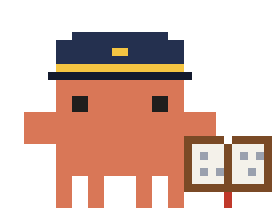

# logbook

Where the context Claude answers you with came from, turn by turn, as far as its events show: which skills it loaded, which MCP servers and tools it called, which files it read, what it fetched or searched on the web, which subagents it started and what each of them used, which programs it ran in the shell and which instruction files feed the session. Each source carries an estimate of the tokens it brought in.

After each reply, one dim line in the transcript:

```
⚓ logbook · skill finops-custos · datadog ×3 · 2 files · 1 web · 1 agent · 2 shell · ≈9k tokens in · ≈1k inside agents · /logbook pane
```

The counts take in the subagents' sources too; the tokens keep them apart. The line is a notice and holds no buttons, so it ends by naming where the sources are listed: `/logbook pane`. A turn with no new sources reads `⚓ logbook · no new sources` alone. The line stays within 1500 characters, the pointer included.

`/logbook pane` opens the timeline, one block per turn, newest first. Each group of a turn is a button: press it to list what is in it, press it again to fold it.

```
2 turns · 12 entries

#2 14:02 investigate the cost spike in production since Friday  ≈9k  collapse all
  ▸ skill  1 finops-custos ≈1k
  ▾ mcp    3 ≈6k
      datadog · search_logs ×2 ≈4k
      datadog · get_metric ≈2k
  ▸ files  1 hooks/report.ts ≈1k
  ▸ web    1 docs.example.com/billing ≈500
  ▾ agents 1 ≈200
      ↳ scan (Explore) ≈1k inside ≈200
        ▸ files  1 src/a.ts ≈1k
        ▸ shell  1 rg ≈300
  ▸ shell  1 aws ≈4

#1 13:58 hi                                                    ≈300  expand all
  ▸ instr  2 .claude/CLAUDE.md, repo/CLAUDE.md ≈300
```

That is the terminal. The desktop, VS Code and the mobile app draw the same rows, each turn in a card, each group a button. Kinds keep their theme colour, so the pane follows your theme. The pane draws the latest 20 turns; older ones wait behind a count (`30 earlier turns not shown`).

## Seeing what a group holds

- **In the pane.** A folded group shows its count and its first 8 items, `+n` for the rest. Pressed, it lists its first 30 items on a row each, with count, failures and tokens, and one row counts the rest (`+170 more`): the shell programs (`git ×2`), the files, `server · tool` for MCP calls, the web hosts, each skill with its source, each instruction file with its tier. The `agents` group lists the first 30 subagents the loop started the same way, each with its type, the tokens it read for itself (`inside`) and handed back, and its own groups under it, each one pressed open the same way, down to the agents it started; deeper rows stop indenting past a few levels. A subagent no spawn in the turn names (one resumed, say), or one in a loop of spawns that name each other, keeps a section of its own at the foot of the turn, the first 30 of them.
- **How much it draws.** Under the turns' own rows the pane draws at most 400 rows and 50,000 characters, newest turn first. Past that a turn says `more than the pane draws: collapse a group or a turn to see the rest`; every turn's own row, with its `expand all` or `collapse all`, always draws.
- **A whole turn.** `expand all` on a turn's first row opens every group in it, the subagents' too; `collapse all` folds them again. The turn reads `collapse all` while a group in view is open. Sources that arrive while a turn is open show in its open groups as they come.
- **On the terminal** the buttons take a click in fullscreen; otherwise `ctrl+x tab` gives the pane the keys: Tab walks its buttons, Enter presses the one in focus, the arrows scroll the pane and Esc goes back to the prompt.
- **On the line.** `/logbook details` makes the line under each reply list every source instead of counting them.

Groups start folded, the newest turn's too: a busy turn opened by itself would push the others out of view, and the folded row already shows the first items. What you open or fold stays so for the session as the pane redraws, closes and opens. A group folded back to how its turn draws it keeps no choice. The latest 100 choices are kept; past them the oldest is forgotten, and what it chose draws as it starts: a group as its turn's `expand all` says, else folded, and a turn folded. The waiting sources' choices go when a turn takes them; `/logbook clear` and a new session (`/clear`, `--resume`) fold everything. A press writes only that choice: it never touches the log, and a tool call still writes only its own turn and the count.

## What it records

| Kind     | Source                                                     | Label                                                                                                           |
| -------- | ---------------------------------------------------------- | --------------------------------------------------------------------------------------------------------------- |
| `skill`  | A skill the Skill tool loaded, or one you typed (`/name`)  | The skill's name; its source (user, project, a plugin by name)                                                  |
| `mcp`    | An MCP tool call, an MCP resource read or listing          | `server · tool` (`datadog · search_logs`); a connector known only by an id reads `connector`                    |
| `files`  | Read; Grep, Glob and NotebookRead where the build has them | The path's last two segments; `grep in <path>`, `glob in <path>`, never the pattern                             |
| `web`    | WebFetch, WebSearch                                        | An http(s) URL's host and first path segment; any other URL's protocol (`data:`); `web search`, never the query |
| `agents` | A subagent, a workflow agent, a teammate                   | Its description and type; its own sources nest under it                                                         |
| `shell`  | Bash, PowerShell                                           | The program name only (`git`, `aws`), never the arguments; `shell` when the first word looks like a key         |
| `instr`  | The instruction files behind the session (CLAUDE.md, ...)  | Path's last two segments; again only when one changes                                                           |
| `other`  | Any other tool (Edit, Write, TodoWrite, Workflow, ...)     | The tool's name                                                                                                 |

On this build Claude has no Grep, Glob or NotebookRead tool: it searches with Bash (`rg`, `grep`, `find`), so searches show under `shell` with the program's name.

A subagent's sources belong to the turn that started it, even when it runs in the background and finishes later; the pane updates, the line already shown does not. If that turn is gone (`/logbook clear`, or past the 50 kept), the agent goes on in the open turn under its own name. A call that was denied is not recorded; one that failed is, marked `(1 failed)`. Tool calls and agents a plugin makes on its own are left out: they feed that plugin, not the conversation.

Tokens are estimates: a source's result as the model reads it, length / 4. A skill counts its prompt plus the Skill tool's result; any other tool, its result. A subagent counts the first report it hands back. On the line, `tokens in` is what the main conversation took in; `inside agents` is what the subagents read for themselves, which reaches the conversation only through their reports. Not counted: a workflow agent's report, which goes to its script (the Workflow tool's own result is, once, under `other`), and a teammate's reports after its first run, which reach the conversation as messages in later turns.

## What it keeps

- Per turn: its number, the time it started and its title, the prompt's first eight words without markup.
- Per source: its kind, its label as in the table, how it came in (the tool, the skill's source, the agent type, the instruction file's tier), the loop it was used in, its estimated tokens and whether it failed.
- Per subagent: its id, description and type, the loop that started it and its turn; the ids of agents plugins started.
- The full paths and lengths of the instruction files seen, so each is recorded once.
- Which of the pane's groups you opened or folded, by turn, loop and kind (`t3-main-shell`, a subagent's `t3-a:<id>-file`), the latest 100.

Every label, title, description and source (a skill's plugin name, say) goes through a redactor first: a word of 16 or more characters mixing letters and digits, or one that starts like a known token (`AKIA`, `ghp_`, `sk-`, `xoxb-`, `AIza`, `eyJ`, ...), becomes `…`. No command line, search pattern, query, URL query or credentials, file content or tool output is kept. Control and format characters are drawn as spaces.

It keeps the latest 50 turns, 200 entries per turn and 200 waiting for a turn. Past 200 a turn drops the oldest entry of its busiest subagent first, then the main conversation's oldest, and the entries that started agents last.

The log lives in Claude Code's session state, in memory only: nothing is written to disk, a restart or `--resume` starts it empty and `/clear` starts it over. Other plugins can read it, as they can any plugin's state.

## What it cannot see

- Why the model chose a source: its reasoning is not an event.
- What the engine adds by itself: system reminders and other attachments (a subfolder's CLAUDE.md picked up while Claude reads files there, for one), the system prompt, tool descriptions and MCP server instructions. The instruction files behind the session's context are recorded, whatever their tier (managed, user, project, local, memory).
- What reaches the conversation as a message rather than a tool result: a background agent's or a workflow's notification, a teammate's later reports.
- A skill a subagent's definition preloads is listed under the main conversation of its turn.
- Tool calls the API runs itself (server-side tools) are seen only through the client tool that started them.

## Why a notice

The line is a `$.ui.log` notice written when the turn ends: a dim row of its own right under the reply, on every surface, that the model never reads. The engine also lets a hook redraw the turn's closing line or the assistant's message, but neither fits: the closing line (`TurnDuration`) is drawn only on the terminal and carries no turn id, and a reply has several message blocks with no sign of which is the last.

## Model tokens

None. The logbook registers no tool for the model and adds nothing to any prompt, context or result: it only reads the events and passes them on unchanged. When you type `/logbook`, its one-line status enters the conversation like any command's output; what the logbook records and misses comes as a notice the model never reads. Pressing a group in the pane runs in the logbook alone and reaches no model.

## Install

```
/plugin install logbook --marketplace PabloMarquess/drydock
```

## Options

| Option    | Default |                                                         |
| --------- | ------- | ------------------------------------------------------- |
| `summary` | true    | The line under each reply. The pane records either way. |

## Commands

| Command            |                                                                                                             |
| ------------------ | ----------------------------------------------------------------------------------------------------------- |
| `/logbook`         | Status on one line: on or off, entries this session, top sources by tokens                                  |
| `/logbook on`      | Resumes recording and the line, for this session; a turn in progress is recorded from then on               |
| `/logbook off`     | Stops recording and the line, for this session; only when you type it                                       |
| `/logbook pane`    | Shows or hides the timeline; press a group to list its sources, `expand all` to open a whole turn           |
| `/logbook details` | The line lists every source (`datadog search_logs ×2, get_metric`) instead of counts                        |
| `/logbook clear`   | Empties the log; the turn in progress keeps recording and running agents their names; only when you type it |
| `/logbook help`    | Lists these controls                                                                                        |

`off` and `clear` take only what you type (at the prompt, through the SDK or Remote Control): from a channel, a plugin, another session or a scheduled task they change nothing.
